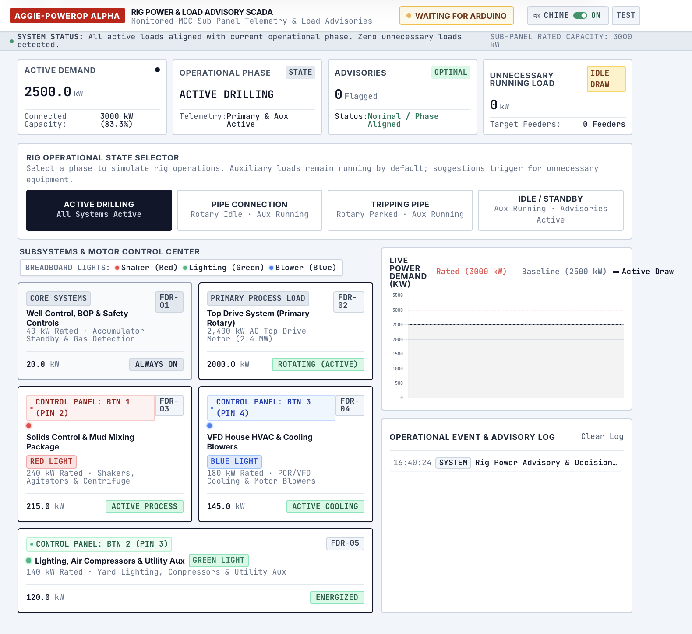
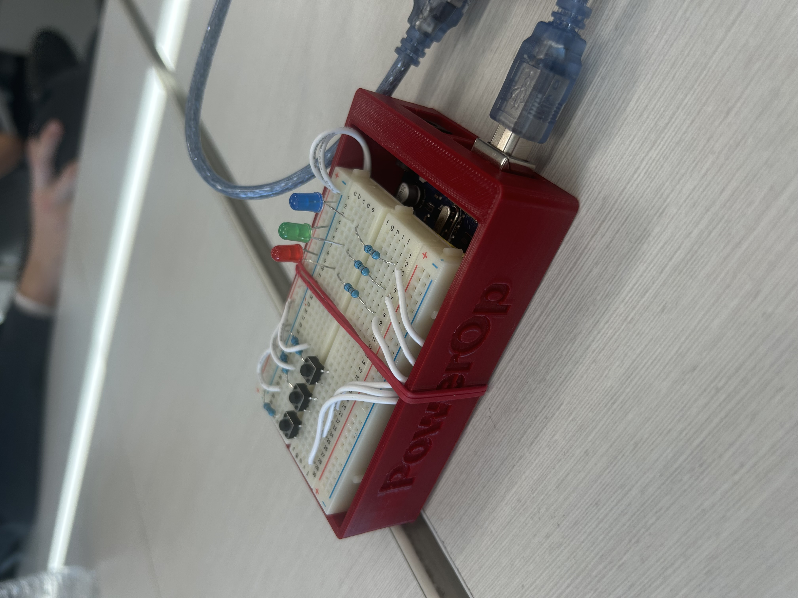
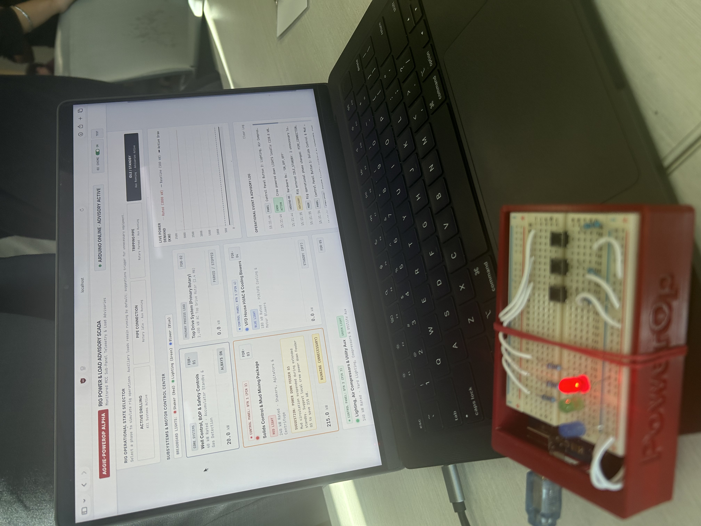

# Aggie-PowerOp Alpha — Rig Power & Load Advisory SCADA

> **1st Place Winner — Texas A&M Aggies Invent (ExxonMobil)**

**Aggie-PowerOp Alpha** is a non-intrusive rig power management and load advisory SCADA system built for off-grid **onshore diesel-electric land drilling rigs**. It identifies unnecessary auxiliary loads during non-drilling phases and enforces a read-only dashboard for operational security, keeping safety-critical well control systems locked ON while requiring all equipment changes to be toggled physically on the breaker. For this **proof of concept**, the system pairs a simulated 3.0 MW rig digital twin with an **Elegoo Mega 2560 R3** acting as a physical **mock breaker**—which would be replaced with real MCC breakers in field deployment.



---

## The Problem

Off-grid land drilling rigs operate with megawatts of connected diesel-electric capacity. In between periods of active drilling, the primary top drive stops, yet auxiliary MCC feeders such as solids control packages, VFD house cooling blowers, and yard lighting/compressors often remain energized, burning unnecessary diesel and generating avoidable emissions.

## Our Solution

Aggie-PowerOp provides a lightweight software and hardware advisory layer over rig MCC feeders:

- **Phase-Aware Load Advisories:** Detects when auxiliary feeders remain energized during `PIPE_CONNECTION`, `TRIPPING`, or `IDLE_STANDBY`, flagging the exact feeders using power unnecessarily with an optional audio chime.
- **Security-First, Read-Only Dashboard (Breaker-Only Control):** For operational security, the SCADA dashboard is strictly read-only for feeder states—remote API and WebSocket toggle commands are rejected, and equipment can **only** be toggled physically on the breaker panel.
- **Proof-of-Concept Setup (Digital Twin + Mock Breaker):** Streams 5 Hz telemetry over WebSockets from a simulated 3.0 MW digital twin paired with an Arduino mock breaker (standing in for real rig MCC breakers in deployment) to model active vs. baseline power consumption.
- **Laptop/Tablet-Ready UI:** Single-file SCADA dashboard built with Tailwind CSS and Chart.js, designed for touchscreens over a local Wi-Fi hotspot.


*Proof-of-concept 3D-printed PowerOp mock breaker housing the Elegoo Mega 2560 R3, tactile feeder switches, and status LEDs (representing a real rig MCC breaker in deployment).*


*Live proof-of-concept demo: the red breaker light (`FDR-03` Solids Control) remains energized during `IDLE / STANDBY`, triggering an advisory on the SCADA dashboard.*

---

## Monitored MCC Feeder Lineup (3,000 kW Rated)

| Feeder | Subsystem | Rated (kW) | Nominal Draw (kW) | Hardware Panel Mapping |
| :--- | :--- | :---: | :---: | :--- |
| **FDR-01** | Well Control, BOP & Safety Controls | 40 | 20 | Always Energized |
| **FDR-02** | Top Drive System (Primary Rotary) | 2,400 | 2,000 (+0–500 torque) | Active during `ACTIVE_DRILLING` |
| **FDR-03** | Solids Control & Mud Mixing Package | 240 | 215 | Button 1 / Pin 2 (**Red LED**) |
| **FDR-04** | VFD House HVAC & Cooling Blowers | 180 | 145 | Button 3 / Pin 4 (**Blue LED**) |
| **FDR-05** | Lighting, Air Compressors & Utility Aux | 140 | 120 | Button 2 / Pin 3 (**Green LED**) |

---

## Repository Structure

```text
Aggie-PowerOp/
├── assets/
│   ├── scada-dashboard.png         # Live SCADA UI screenshot
│   ├── hardware-control-panel.jpg  # Final 3D-printed PowerOp mock breaker panel
│   └── advisory-demo.jpg           # Live breaker light + SCADA advisory demo
├── backend/
│   ├── server.py                   # FastAPI + WebSocket server, PySerial bridge & power model
│   ├── Aggies_Invent_Button_Code.py# Standalone 9600-baud button-panel serial bridge
│   ├── test_arduino.py             # Serial connection test utility
│   └── requirements.txt            # Python dependencies
├── firmware/
│   ├── WIRING.md                   # Elegoo Mega 2560 R3 pinout & electrical safety guide
│   └── micro_rig/
│       └── micro_rig.ino           # Non-blocking Mega 2560 firmware (2000 ms watchdog, 5 Hz JSON)
├── frontend/
│   └── index.html                  # Single-file SCADA web dashboard (iPad Safari compatible)
└── AGENTS.md                       # Engineering specifications & safety requirements
```

---

## Quick Start

### 1. Install Backend Dependencies
```bash
cd backend
pip install -r requirements.txt
```

### 2. Run the SCADA Server
Connect the Arduino control panel over USB (auto-detected, or specify `--port` explicitly):
```bash
python backend/server.py
# Or specify serial port & baud rate:
python backend/server.py --port /dev/cu.usbmodem1101 --baud 9600
```

### 3. Open the Dashboard
- **Local machine:** Open `http://localhost:8000`
- **iPad / Tablet (same Wi-Fi or hotspot):** Open `http://<laptop-local-ip>:8000`

---

## Hardware & Safety Notes

- **Micro-Rig Firmware (`firmware/micro_rig/micro_rig.ino`):** Uses strictly non-blocking `millis()` timing, implements a **2,000 ms serial watchdog** that forces all implements ON in fail-safe mode if communication drops, and monitors a `10kΩ` torque potentiometer on `A0` (`>850` ADC triggers a torque spike alarm).
- **Wiring (`firmware/WIRING.md`):** Power external actuators (stepper, servo, DC fan, relay) from an external 5V breadboard power module with a **shared `GND`** to the Elegoo Mega 2560 R3.

---

## Acknowledgments

Built during **Aggies Invent** hosted by the **Meloy Engineering Innovation and Entrepreneurship Program** at **Texas A&M University**, in partnership with **ExxonMobil**.
